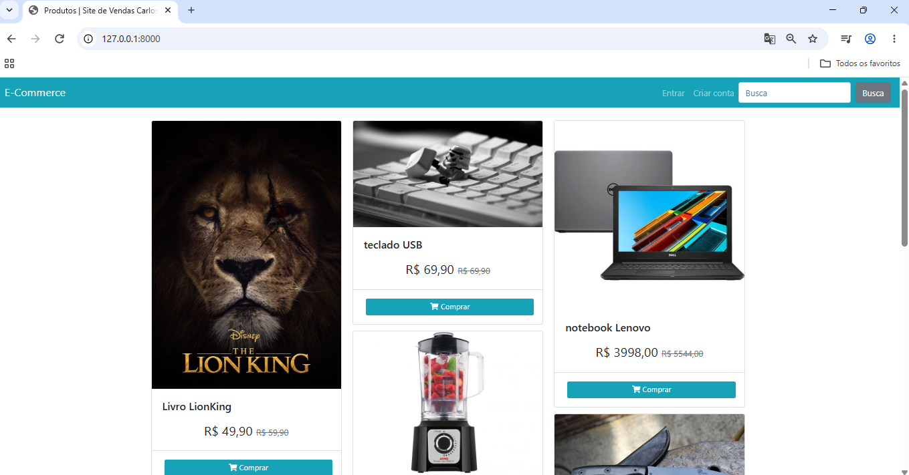

Projeto E-commerce com Python e Django

Neste vídeo, mostro o desenvolvimento completo de uma loja virtual (e-commerce) utilizando Python e Django, do zero até um site de vendas funcional.

O que você vai ver:

Configuração do ambiente e estrutura do projeto
Criação de models, views e templates
Cadastro e listagem de produtos
Carrinho de compras e fluxo de pedidos
Boas práticas de organização do código em Django

